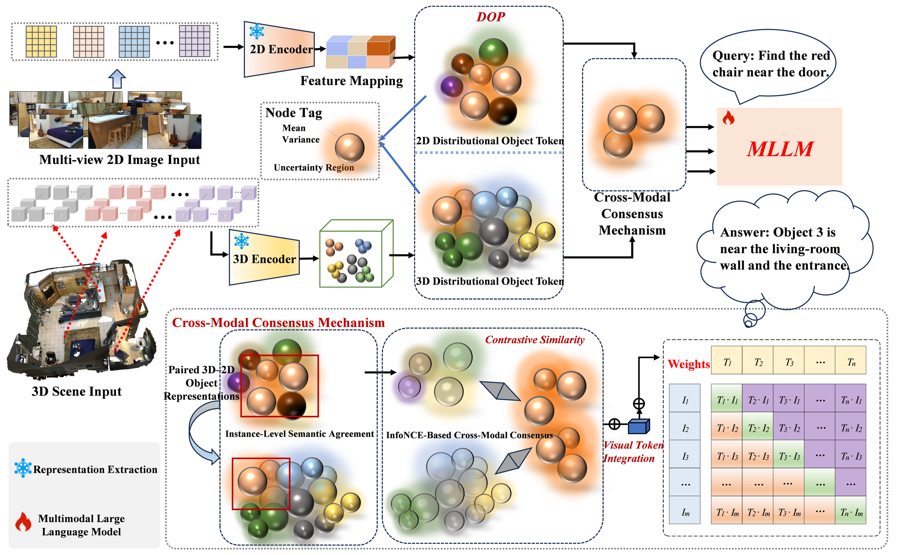

<h1 align="center">Consensus3D</h1>
<p align="center"><strong>Constructing Probabilistic Object Representations for 3D Scene Understanding</strong></p>

> **Code release status.** This is a partial code release containing the DOP
> object encoder, object-token construction, language-model fine-tuning utilities,
> and architecture and training documentation. The complete project, including
> the training and evaluation pipeline, will be released upon acceptance of the paper.
> See [release contents](#release-contents) for the current scope.

<p align="center">
  <a href="#method">Method</a> ·
  <a href="#results">Results</a> ·
  <a href="#getting-started">Getting started</a> ·
  <a href="docs/data_preparation.md">Data preparation</a> ·
  <a href="docs/configuration.md">Training settings</a>
</p>

Consensus3D learns probabilistic representations of an object's geometry and
appearance, and aligns their shared semantics before language reasoning.
The resulting object tokens support 3D visual grounding, dense captioning,
and question answering through a common language interface.

<p align="center">
  
</p>

CMC provides instance-level contrastive supervision during training. The language
model receives an interleaved sequence of object identifiers, geometry tokens
and appearance tokens.

## Method

- **Distributional Object Projector (DOP).** Independent geometry and appearance
  branches learn object distributions in the language embedding space. Their
  means encode object semantics, while learned variances represent ambiguity
  in the visual evidence.
- **Cross-Modal Consensus (CMC).** An instance-level contrastive objective aligns
  the paired 2D and 3D representations of the same object. Together with response
  supervision and distributional regularization, it learns object tokens that
  preserve complementary evidence across modalities.
- **Stable probabilistic learning.** Low-variance initialization and deterministic
  warm-up establish the object-language mapping before sampled-token training.
  Inference uses the learned means.

The [architecture guide](docs/architecture.md) explains the complete flow from
scene observations and object proposals to language-model responses.

## Results

Results reported in the paper across five 3D scene-understanding benchmarks:

| Method | ScanRefer Acc@0.5 | Multi3DRefer F1@0.5 | Scan2Cap CIDEr@0.5 | ScanQA CIDEr | SQA3D EM |
| --- | ---: | ---: | ---: | ---: | ---: |
| Consensus3D | 52.2 | 55.1 | 77.4 | 89.6 | 55.0 |

Feature-removal experiments further show improved grounding robustness with
incomplete object evidence. Learned uncertainty increases as feature information
is removed and is associated with harder-to-ground objects.

## Release contents

| Component | Available material |
| --- | --- |
| Framework architecture | [Guide](docs/architecture.md) covering scene inputs, paired features, probabilistic object tokens, language reasoning and task outputs |
| DOP and object-token construction | [Executable module](consensus3d/consensus3d.py) with independent modality branches, low-variance initialization, staged sampling, mean inference and valid-object masking |
| Language-model fine-tuning | [Executable utilities](consensus3d/finetuning.py) for LoRA, the trainable-parameter policy and selective input gradients |
| Optimization settings | [Manuscript reference configuration](configs/consensus3d_7b.json) and [schedule and loss definitions](docs/configuration.md) |
| Data preparation | [Dataset and preprocessing links](docs/data_preparation.md), feature formats and object-correspondence requirements |
| Module verification | [Object-encoder example](examples/inspect_object_encoder.py), [DOP-to-LLM interface check](examples/inspect_language_interface.py), and [tests](tests/test_modules.py) |

The complete release will add the end-to-end trainer, CMC/KL loss implementations,
task data loaders, prompt/target assembly, preprocessing and benchmark evaluation
scripts, and trained checkpoints. Dataset and pretrained-model sources are
listed in [data preparation](docs/data_preparation.md).

## Getting started

Use a Python 3.12 environment. The module example and tests have been checked
with PyTorch 2.6.0 on CPU, Transformers 4.39.3 and PEFT 0.9.0.
The examples run locally on CPU with randomly initialized models and synthetic inputs.

```bash
git clone https://github.com/gongyu0829/Consensus3D.git
cd Consensus3D
python -m pip install torch==2.6.0 --index-url https://download.pytorch.org/whl/cpu
python -m pip install -r requirements.txt
python examples/inspect_object_encoder.py
```

The example uses small, randomly initialized DOP branches and synthetic paired
features to inspect mean-based inference and object-token construction. The
output should contain:

```text
"projected_shape": [2, 4, 32]
"object_sequence_lengths": [9, 6]
"initial_log_variance": -9.0
"evaluation_uses_means": true
```

For the paper's projector dimensions, the same example reads the architecture
settings from the JSON configuration and projects 1024-dimensional features to
4096-dimensional object tokens:

```bash
python examples/inspect_object_encoder.py --full-dimensions
```

To check deterministic warm-up, the transition to sampling, object masks,
token ordering and gradients, run:

```bash
python -m unittest discover -s tests -v
```

The six tests also apply PEFT LoRA to a small randomly initialized Llama model
and check the trainable parameters and input-gradient routing.

To inspect how object tokens connect to a language model, run:

```bash
python examples/inspect_language_interface.py
```

This CPU example connects the DOP branches to a small randomly initialized Llama.
It masks the synthetic input prefix from the language loss, checks gradients
through both DOP branches, LoRA, object identifiers and the output head, and checks
mean-based evaluation with gradient checkpointing configured. All entries in
`checks` should be `true`. Reduced dimensions and synthetic token IDs make the
interface example lightweight and self-contained.

## Data and training

Mask3D provides object proposals, and frozen Uni3D and DINOv2 encoders supply
paired geometric and multi-view appearance features. Each object's identifier
and visual tokens are combined with the language instruction and passed to
[Vicuna-7B-v1.5](https://huggingface.co/lmsys/vicuna-7b-v1.5).

The manuscript's training setup jointly optimizes DOP, LoRA adapters, the input
embedding matrix and the language output head. It uses two RTX 4090 GPUs, 16 training
samples per GPU (32 globally), three epochs and an effective base learning rate of
`1.6e-4`. Evaluation uses 16 samples per GPU.
Deterministic DOP warm-up and learning-rate warm-up have separate schedules.
See [data preparation](docs/data_preparation.md) for dataset and feature sources,
and [training settings](docs/configuration.md) for the optimization details.

## License

The project is available for noncommercial academic evaluation under the
[Academic Evaluation Source License](LICENSE). Third-party copyright and
license information is collected in [licenses](licenses/NOTICE.md).
